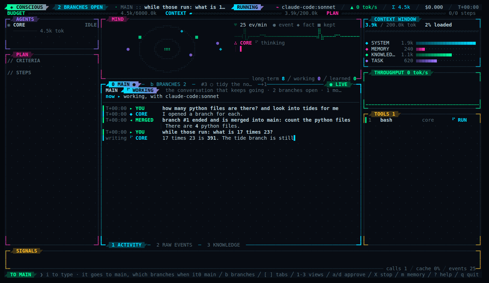

# conscious

A self-learning agent harness in Rust. You talk to one conversation that keeps going. When something is real work it opens a branch that runs by itself and merges the result back. It learns from how its work went and from your feedback, and it can rewrite its own code, including its own Rust source, behind a gate.



*The main conversation. A branch has merged its result back, two more are at work, and a reply is being written. Rendered from the interface code with example data.*

**Status: working prototype.** One developer, about 250 tests. Read [What is not done](#what-is-not-done) before relying on it.

```sh
git clone https://github.com/ttheekw/Conscious-Mind
cd Conscious-Mind
./install.sh
conscious
```

## Why this exists

Agent harnesses today are good at doing what they are told and poor at getting better at it. Their behaviour lives in code a person wrote and prompts a person tuned. When the agent hits a limit in the harness itself (a tool it lacks, a rule that is wrong, a threshold picked by guesswork), it stops and a person has to fix the harness.

`conscious` is built on the opposite assumption: **the harness should be able to change itself, and the hard problem is making that safe.** So the design is a split, applied at every level:

- **What the behaviour is** may be written by a model.
- **Whether a change is adopted** is decided by compiled, deterministic code that no model can talk its way past.

### It rewrites itself at four levels

| Level | What changes | What decides whether the change is kept |
|---|---|---|
| **Lessons and skills** | After real work it writes down what a later task should not have to work out again: a rule, know-how for one kind of task, or a step-by-step skill. | Starts unconfirmed. Confirmed by a passing check or a good rating, retired by failed runs or bad ratings. Capped in number and length; repeats are merged. |
| **Limits** | The thresholds that govern learning (how much support a rule needs, how many rules may stand, how long a lesson may be). | Each has a compiled floor and ceiling and moves one step at a time, only on a stated amount of evidence. No model decides. |
| **Decision policy** | How evidence becomes a model choice is an interpreted [Rhai](https://rhai.rs) script, not compiled code, so the core model can rewrite it. | A regression gate: it must never error, answer the same twice, keep fixed behaviours, and score no worse than the policy in use when replayed against recorded outcomes. Rolled back automatically if it then draws bad ratings. |
| **Its own Rust source** | When a task cannot be done because of how the harness is built, the agent asks for the harness to be changed. The change is written in a copy of the source. | `cargo fmt --check`, `cargo clippy -D warnings` and the whole test suite must pass in a sandbox with no network. No existing test may be removed or renamed, and a new test must come with the change. Then it rebuilds, restarts into the new build, and takes the change back if the new build does not come up. |

Nothing is beyond changing, the guardrails included. But a change that touches the guardrails, the agent loop, the self-update gate itself or the build files is put to you as an approval request showing the diff line by line, whatever mode the harness is in. Everything else that passes the gate is adopted without asking.

Honest limits of the last level: the gate catches removed tests but cannot tell a weakened assertion from an honest one, and the full path from gate to restart has been tested in parts but not yet run end to end on a real change. Treat it as experimental. `--no-self-update` turns it off.

### The other positions it takes

- **One conversation, like a git main line.** Everything you say goes to *main*, which never ends. Main decides when something is work of its own and opens a *branch*: a tab that works by itself in the background and is *merged* back into main when it ends. Main cannot change files itself, so it stays free to talk while branches work. *Routines* are jobs set to repeat or start later; each run is a branch.
- **Context is assembled, not accumulated.** Each model call gets the task's own recent turns plus what a lookup finds relevant. Nothing is carried along just because it was said earlier.
- **Memory is understood before it is stored.** A small model reads each exchange and files it by what it means. Lookups go by words, by graph links and by meaning, using an embedding model that runs on your machine.
- **It judges its own work.** Each task gets success criteria before it starts and is checked against them when it ends. When your response disagrees with the criteria, a learner works out what you meant, for next time.
- **Guardrails are enforced by the harness, not the prompt.** Every tool call passes a compiled check first. The loop refuses any tool that was not offered, whatever the model asks for.
- **Everything is an event.** Each step is appended to a timeline the screen is drawn from, so "why did it do that?" has an answer.

## Compared with Hermes Agent and OpenClaw

[Hermes Agent](https://github.com/nousresearch/hermes-agent) and [OpenClaw](https://docs.openclaw.ai) are the reference points. Both are released products with large communities; this is a prototype. Several agent behaviours here were taken from them: self-written skills, compaction inside a long task, memory tools, sub-agents, project instruction files.

This is a comparison of designs, not a benchmark: neither was run side by side with `conscious`. What is said about them comes from their documentation and the write-ups listed under [Sources](#sources), read in November 2026, and may be out of date.

| Area | conscious | Hermes Agent | OpenClaw |
|---|---|---|---|
| Shape | One main conversation; branches merge back | Many sessions | Many sessions |
| Long-term memory | Graph of notes, passages and terms; every exchange read by a model and filed by meaning | Two small curated files loaded each session, plus search over past sessions | Markdown files: a curated file plus daily logs |
| Recall | Automatic lookup on every message, plus a `recall` tool | Curated files always loaded; the agent searches when it wants more | Curated file loaded; the agent calls memory search |
| Search by meaning | Built in, local embedding model | Through add-on memory providers | Built in |
| Knowledge of the project | Code and docs ingested into the same graph | Files the agent reads | Files the agent reads |
| Model choice | Rates each task 1 to 5; a policy picks a model family from recorded results | Set by the user | Set by the user |
| Self-written skills | Yes, retired by rating | Yes, with a curator | Yes |
| Lessons from tasks | Yes; confirmed or retired by outcomes and ratings | The agent may write to its memory file | The agent may write to its memory files |
| Rewrites its own decision logic | Yes: an interpreted script, gated and rolled back automatically | Not described in its docs | Not described in its docs |
| Rewrites its own source code | Yes, behind a test gate with restart and rollback (experimental) | Not described in its docs | Not described in its docs |
| Success criteria per task | Written before, checked after, corrected by your response | Not described in its docs | Not described in its docs |
| Scheduled runs | Yes: by time, or when a file changes | Yes (cron) | Yes (heartbeat, cron) |
| Guardrails | Compiled policy, OS sandbox, hard budgets, stall check | Approval prompts and sandbox options | Approval prompts and sandbox options |
| Connectors and channels | A Telegram bot, and nothing else | Many | Many |
| Memory you can edit by hand | No: one JSON graph, seen through the terminal UI | Yes, plain files | Yes, plain Markdown |
| Offline fine-tuning from its own runs | No | Yes | Not described in its docs |
| Maturity | Prototype, one developer | Released, large community | Released, large community |

**Where they are ahead:** reach (many messaging channels, connectors, MCP), maturity, memory you can open in an editor, and Hermes's path from its own runs to a fine-tuned model. `conscious` has none of those. Its exposure to outside input is smaller mostly because it does less.

**Where this is different:** they are assistants you message; `conscious` is meant to learn from its own results and change itself. Model routing that learns, criteria it checks itself against, limits that move with evidence, and gated rewriting of its policy and its source are the point of the project.

## Install

**You need:**

- Linux or macOS.
- Rust (stable): <https://rustup.rs>. A C compiler (`sudo apt install build-essential` on Debian/Ubuntu).
- One model backend:
  - [Claude Code](https://claude.com/claude-code) installed and signed in, or
  - the Codex CLI installed and signed in, or
  - an OpenAI-compatible endpoint: `OPENAI_API_KEY`, `OPENROUTER_API_KEY`, or a local server such as `llama-server` or Ollama (`CONSCIOUS_LOCAL_URL`, default `http://127.0.0.1:8080/v1`).
- Recommended on Linux: [bubblewrap](https://github.com/containers/bubblewrap) (`sudo apt install bubblewrap`), so shell commands run in a sandbox. Without it they still run, with more of them asking first.

**Install:**

```sh
git clone https://github.com/ttheekw/Conscious-Mind
cd Conscious-Mind
./install.sh
```

The script builds a release binary, copies it to `~/.local/bin/conscious`, and runs `conscious check`, which reports what your machine has and which model would be used. It never uses `sudo` and installs nothing else. The first build downloads the ONNX Runtime library and takes a few minutes. On first run, a small embedding model (about 65 MB) is downloaded to `~/.cache/conscious/models`; it runs locally and nothing you embed leaves your machine.

**The first start sets things up, once.** It checks that a model really answers, then offers to connect a Telegram bot (optional; Enter skips it). `conscious` brings no model of its own: it works through Claude Code or Codex (or a running local server, or an OpenAI / OpenRouter model you name). The first time you run it, it says so, shows what it found on your machine, and sends one small request to make sure the model answers, before anything else starts. If none does, it stops and tells you how to sign in.

`PREFIX=/some/dir ./install.sh` installs elsewhere. `./install.sh --uninstall` removes the command and keeps your data.

**Without installing:** `cargo run` in the source folder does the same as `conscious`.

**To try it with no model at all:** `conscious --demo`.

## Use

Go to a project folder and run:

```sh
conscious
```

That one command starts everything: it starts a background process if none is running and attaches the screen to it, checks the machine and picks a model, reads the project in the current folder into the knowledge graph, and switches on memory, routing and learning. Closing the screen (`q`) leaves it working.

| Key | What it does |
|---|---|
| `i` | Type a message. It goes to main, or is a reply in the open branch once that has answered. |
| `n` | Type a message to main, wherever you are. |
| `0` / `b` | Main / the list of branches. |
| `]` `[` | Next / previous tab. |
| `e` | Show branches that have ended, or hide them again. |
| `1` `2` `3` | In a tab: the conversation, every raw event, knowledge and memory. |
| `a` / `d` | Accept / deny a call that is waiting for you. |
| `+` / `-` | Rate the result. Routing, skills and lessons learn from it. |
| `m` | Open a memory. The marks on the map are clickable too. |
| `K` | Type a secret (a key or token) into its own window. |
| `X` | Stop what the open tab is doing. |
| `?` | Help. |

Useful commands:

```sh
conscious check            # what this machine has, and which model would be used
conscious telegram         # connect a Telegram bot and pair it with your account
conscious status           # whether it is running in the background, and on what
conscious stop [--force]   # end the background process
conscious lessons          # what it has learned, and how each lesson has fared
conscious tuning           # the learned limits, and why each moved
conscious policy           # the routing policy: version, history, rejected rewrites
conscious selfupdate       # what it has tried to change in its own code
conscious schedule         # routines it has set for itself
conscious --help           # everything else
```

Your data (memory, timeline, skills, policy versions) is in `~/.local/share/conscious`.

### Secrets

Keys, tokens and passwords never go to a model. Press `K` and type one into its own window: the value is drawn only as dots, goes straight to a store on your machine, and is never written to the timeline or put in anything a model reads. When the agent needs one it does not have, the window opens by itself, saying what it is for.

The agent knows a secret only by its name. It uses one by writing `$NAME` in a shell command; conscious puts the value in that command's environment, asks you first every time, and removes the value from the output the model gets back. `conscious secrets` lists the names you have stored, and `conscious secrets remove NAME` forgets one.

An `OPENAI_API_KEY` or `OPENROUTER_API_KEY` entered this way is used for that backend, so you do not need to export it.

### Telegram

You can talk to the main conversation from Telegram.

The first time you run `conscious` it offers this as an optional last step of setting up. To do it at any other time, run:

```sh
conscious telegram
```

It walks you through three steps:

1. In Telegram, message [@BotFather](https://t.me/BotFather), send `/newbot`, and copy the token it gives you.
2. Paste the token when asked. It is not shown as you type, is checked with Telegram, and is stored as a secret that no model sees.
3. It prints a link to your bot and a line such as `/pair 482913`. Send exactly that to the bot from your own Telegram account, and it is paired.

If conscious was already running in the background, run `conscious stop` and then `conscious` so that it picks the bot up. (You can also enter the token inside conscious: press `K` and name the secret `TELEGRAM_BOT_TOKEN`; the pairing line then appears in the conversation.)

From then on:

- **Messages.** What you send the bot is said to main. Main's replies, and the results of its branches, come back to you there.
- **Approvals.** When a call needs your approval, the bot sends it with **Approve** and **Deny** buttons. Pressing one decides it, the same as at the screen, and the message then shows what was decided.
- **Photos, video, audio, voice notes and files.** Send one (up to 20 MB, Telegram's limit for bots) and it is saved in the project folder under `telegram-inbox/`, and main is told where it is and what you wrote with it. The models conscious uses take text only, so the agent can work on the file with its tools (convert it, read its metadata, run a script over it) but cannot look at a picture or listen to a recording.

Only the account that sent the pairing code is heard, and only its button presses count; group chats are ignored. Two things can never be done from Telegram and wait for you at the screen: entering a secret, and approving a change to what the agent itself is allowed to do. While a bot is connected, the background process keeps running.

What main says to you over Telegram passes through Telegram's servers.

## Safety

An agent that acts by itself needs limits it cannot argue with.

- Every tool call passes `Guard::check` first: allow, ask you, or deny.
- **Careful mode** (the default): changing files and most commands ask first.
- **Trusted mode** (you grant it; the agent cannot grant itself anything): file changes and ordinary commands run without asking. Deleting, the network, installs, and anything outside the folders you allowed still ask. `sudo` and similar are always refused.
- With bubblewrap, commands can only write inside the allowed folders and have no network unless you approved that command. Without it, trusted mode judges a command from its text alone. That is a net with holes: a script the command runs can do what its text does not say.
- Hard limits per run on steps, tokens and time, and a stall check.
- Tool output, web pages and retrieved knowledge are given to the model as data, never as instructions. Secrets are redacted from context, logs and the screen.

This is a prototype that runs shell commands on your machine. Use it in folders you can afford to have changed, and keep your work in version control.

## What is not done

- The self-update path has not been run end to end on a real change.
- The goal loop: it checks its result against the criteria but does not yet carry on by itself until they are met.
- MCP, connectors and messaging channels.
- Starting at login: after a reboot nothing runs until you start it once.
- The Codex backend is untested with tools; Claude Code is the backend it has been exercised with.
- Secrets are kept as a plain file readable only by you, not in the system keyring.

## Licence

[MIT](LICENSE).

## For contributors and coding agents

[`AGENTS.md`](AGENTS.md) is the detailed design record: every module, its boundaries, and why each decision was made. A change should pass:

```sh
cargo fmt --check
cargo clippy --all-targets -- -D warnings
cargo test
```

## Sources

For the comparison above.

**Hermes Agent:** [docs](https://hermes-agent.nousresearch.com/docs) · [repository](https://github.com/nousresearch/hermes-agent) · [skills guide](https://www.mintlify.com/NousResearch/hermes-agent/user-guide/features/skills) · [memory guide](https://www.mintlify.com/NousResearch/hermes-agent/user-guide/features/memory) · [Inside Hermes Agent](https://saulius.io/blog/hermes-agent-self-improving-ai-architecture) · [How Hermes Agent memory works](https://vectorize.io/articles/hermes-agent-memory-explained)

**OpenClaw:** [memory docs](https://docs.openclaw.ai/concepts/memory.md) · [memory architecture](https://docs.openclaw.ai/concepts/memory-architecture) · [The agent loop and skills](https://practiceoverflow.substack.com/p/the-agent-loop-and-skills-how-openclaw) · [memory masterclass](https://velvetshark.com/openclaw-memory-masterclass) · [A security analysis of the OpenClaw agent framework](https://arxiv.org/pdf/2603.27517)

The approach to keeping learned rules from bloating follows TextReg ([arXiv 2605.21318](https://arxiv.org/abs/2605.21318)).
